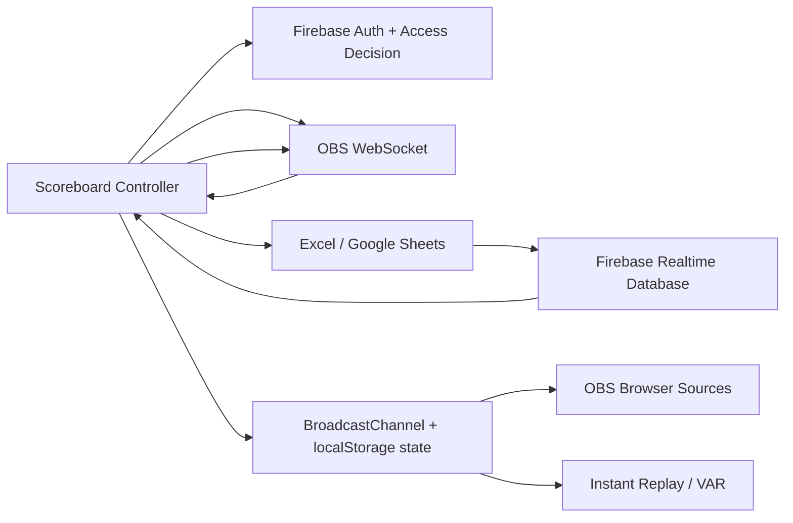

# รายงานวิเคราะห์โปรเจกต์ OBS Football Scoreboard

**วันที่ตรวจสอบ:** 24 สิงหาคม 2026  
**โปรเจกต์:** `obs-football-scoreboard`  
**ประเภท:** Vite SPA สำหรับควบคุม Football Scoreboard, OBS Studio, Replay และ Overlay  
**ขอบเขต:** ตรวจโครงสร้างไฟล์, source code, configuration, scripts, tests, เอกสาร, deployment workflow และ asset inventory ที่อยู่ใน workspace

> รายงานนี้เป็นการวิเคราะห์จากโค้ดจริงใน repository ณ วันที่ตรวจสอบ ไม่ใช่เอกสารเชิงคาดเดา ไฟล์ binary เช่น `.xlsx`, `.png`, `.jpg`, `.otf`, `.exe` และ `.pyc` ถูกตรวจในระดับ inventory/การอ้างอิงจากโค้ด ไม่ได้ถอดเนื้อหาภายใน binary ทุกไฟล์

## 1. สรุปผู้บริหาร

โปรเจกต์นี้เป็นแอป React 19 แบบ Single Page Application ที่ทำหน้าที่เป็นศูนย์กลางควบคุมการถ่ายทอดฟุตบอล โดยแบ่งความรับผิดชอบหลักออกเป็น 5 กลุ่ม:

1. **Scoreboard Controller** — แก้ชื่อทีม, คะแนน, สี, โลโก้, timer, label และส่งข้อมูลไป OBS
2. **Firebase/Excel League** — อ่านไฟล์ Excel หรือ Google Sheets, แปลง mapping, เชื่อม Firebase Realtime Database และบันทึกผลการแข่งขัน
3. **OBS Integration** — เชื่อม `obs-websocket-js`, อัปเดต Text/Image/Color Sources, สร้าง Scene และ Browser Sources อัตโนมัติ
4. **Broadcast Overlays** — ตารางลีก, ผลการแข่งขัน, ticker, stadium view, score/team-name/logo animation และ penalty dots สำหรับ OBS Browser Source
5. **Replay/Automation** — Instant Replay, VAR Replay V2, macro automation, hotkeys และ cross-window communication ผ่าน `BroadcastChannel`

ภาพรวมคุณภาพปัจจุบัน:

| ด้าน | สถานะ | ข้อสังเกต |
|---|---|---|
| Build | ผ่าน | `tsc -b`, Vite build และสร้าง `404.html` สำเร็จ |
| Tests | ผ่าน | 17 test files, 127 tests ผ่านทั้งหมด |
| Lint | ผ่าน | `oxlint` จบด้วย exit code 0 |
| Tailwind verification | ผ่าน | script ตรวจสอบครบทุกข้อ |
| Type safety | ต้องปรับปรุงมาก | `tsconfig` ยังไม่เปิด `strict` และมี `any` หลายจุด |
| Security boundary | ต้องตรวจสอบ/เสริมทันที | สิทธิ์ส่วนใหญ่ตรวจที่ client และยังไม่พบ Firebase Rules ใน repository |
| Bundle size | ต้องปรับปรุง | build เตือน chunk ใหญ่; `exceljs` และ `xlsx` มีขนาดสูง |
| Maintainability | ปานกลาง | feature ครบ แต่ Controller และ logic ซ้ำมีขนาดใหญ่ |

## 2. เทคโนโลยีและ dependency

### Runtime

- React `19.2.7`
- React DOM `19.2.7`
- React Router DOM `7.18.1` โดยใช้รูปแบบ `BrowserRouter`, `Routes`, `Route`, `Navigate`
- Firebase `12.16.0`
  - Google Authentication
  - Realtime Database
- `obs-websocket-js` `5.0.8` สำหรับ OBS WebSocket 5.x
- `react-easy-crop` สำหรับ crop โลโก้
- `xlsx` และ `exceljs` สำหรับอ่าน Excel คนละความสามารถ

### Build/test/tooling

- Vite `8.x`
- TypeScript `6.x`
- Vitest `4.x` + jsdom + Testing Library
- Oxlint
- Tailwind CSS `3.4.17` + PostCSS + Autoprefixer
- GitHub Pages deployment ผ่าน GitHub Actions
- Vercel rewrite configuration ผ่าน [`vercel.json`](vercel.json)

### NPM scripts

| Script | การทำงาน |
|---|---|
| `npm run dev` | เปิด Vite development server |
| `npm run build` | ตรวจ TypeScript, build Vite และสร้าง `dist/404.html` สำหรับ GitHub Pages SPA fallback |
| `npm run lint` | รัน Oxlint |
| `npm run test` | รัน Vitest แบบครั้งเดียว |
| `npm run test:watch` | รัน Vitest แบบ watch mode |
| `npm run preview` | เปิด preview ของ build |
| `npm run deploy` | build แล้ว deploy `dist` ผ่าน `gh-pages` |
| `npm run verify:tailwind` | ตรวจไฟล์/config/component ของ Tailwind |

## 3. โครงสร้างโปรเจกต์

### Root directories

| Path | จำนวนโดยประมาณ | หน้าที่ |
|---|---:|---|
| `src/` | 134 files | React application, hooks, services, types, utils และ tests |
| `public/logos/` | 136 files | โลโก้ทีมที่ให้บริการแบบ static |
| `images/` | 12 files | background, logo และภาพประกอบ |
| `logos/` | 10 files | โลโก้ root สำหรับ legacy/dev logo endpoint |
| `excel/` | 4 files | ตัวอย่าง/ข้อมูล Excel รวมไฟล์ temporary ของ Excel |
| `fonts/` | 1 file | `Srinakharinwirot-Regular.otf` |
| `plugin/` | 3 files | Lua hotkey bridge และไฟล์ installer/replay plugin |
| `docs/` | 3 files | เอกสาร Tailwind |
| `.kiro/specs/` | 3 feature specs | design/requirements/tasks ของ Instant Replay, mobile table และ unified logo path |
| `.github/workflows/` | 1 workflow | GitHub Pages CI/CD |
| `dist/` | generated | output จาก build; ถูก ignore ใน Git |

### Source layers

```text
src/
├─ App.tsx                       # Router และ route-level lazy loading
├─ main.tsx                      # React root + StrictMode + global CSS
├─ components/                   # Controller, modal, overlay, replay และ animation UI
├─ config/                       # Firebase auth และ OBS source configuration
├─ constants/                    # translations และ upload configuration
├─ context/                      # Auth access และ OBS video-folder context
├─ hooks/                        # stateful business logic และ integration lifecycle
├─ macros/                       # macro types, storage, trigger, subscription, executor
├─ pages/                        # test/demo pages
├─ services/                     # OBS setup service
├─ styles/                       # local font CSS
├─ types/                        # domain models และ type guards
└─ utils/                        # Excel, URL, logo, replay และ trial-access utilities
```

## 4. Application bootstrap และ routing

จุดเริ่มต้นอยู่ที่ [`src/main.tsx`](src/main.tsx):

1. import `src/index.css`
2. render `<App />` ด้วย `StrictMode`
3. ใช้ non-null assertion กับ `document.getElementById('root')`

[`src/App.tsx`](src/App.tsx) ทำหน้าที่:

- คำนวณ `basename` จาก `import.meta.env.BASE_URL`
- ครอบทั้งแอปด้วย `BrowserRouter`
- ครอบด้วย `ObsVideoFolderProvider` เพื่อให้ Controller และ Replay ใช้ folder state เดียวกัน
- lazy-load หน้าใหญ่ทั้งหมดด้วย `React.lazy`
- ใช้ Suspense fallback ภาษาไทย
- redirect `/controller` ไป `/`
- รองรับ GitHub Pages ที่ base path `/React_Scoreboard/` และ Vercel ที่ `/`

### Route inventory

| Route | Component | Protection | วัตถุประสงค์ |
|---|---|---|---|
| `/` | `ScoreboardController` | `AuthGuard` | หน้าควบคุมหลัก |
| `/controller` | redirect | - | legacy alias |
| `/admin/whitelist` | `AdminWhitelist` | ตรวจ Super Admin ภายใน component | จัดการสิทธิ์ผู้ใช้ |
| `/whitelist` | `AdminWhitelist` | ตรวจ Super Admin ภายใน component | legacy alias |
| `/overlay` | `OverlayContainer` | public | dynamic Firebase overlay หลายรูปแบบ |
| `/all-scores` | `AllScoresStandalone` | public | ผลการแข่งขันทั้งหมด |
| `/league-table` | `LeagueTableStandalone` | public | ตารางคะแนน |
| `/all-score-combined` | `AllScoreCombinedStandalone` | public | ตารางคะแนน + ผลการแข่งขัน |
| `/penalty-shootout` | `PenaltyShootoutController` | `AuthGuard` | ควบคุมยิงจุดโทษ |
| `/dots` | `PenaltyDotsOverlay` | public | Browser Source แสดงจุดยิงจุดโทษ |
| `/goal-animation` | `GoalAnimationOverlay` | public | entry point ของ score/team/logo/goal animation |
| `/var-replay` | `VarReplayV2Page mode=control` | `AuthGuard` | legacy VAR controller |
| `/var-replay/screen` | `VarReplayV2Page mode=screen` | public | VAR Browser Source |
| `/var-replay-v2` | `VarReplayV2Page mode=control` | `AuthGuard` | VAR controller รุ่นปัจจุบัน |
| `/var-replay-v2/screen` | `VarReplayV2Page mode=screen` | public | VAR Browser Source รุ่นปัจจุบัน |
| `/replay` | `InstantReplayPage mode=control` | `AuthGuard` | Instant Replay controller |
| `/replay/screen` | `InstantReplayPage mode=screen` | public | Instant Replay Browser Source |
| `/test-tailwind` | `TailwindTestPage` | public | ทดสอบ Tailwind |
| `*` | redirect | - | redirect กลับหน้า `/` |

## 5. Data flow หลักของระบบ



### Controller state

`ScoreboardController` เป็น orchestration component ขนาดประมาณ 2,042 บรรทัด ประกอบด้วย:

- match state: ชื่อทีม, คะแนน, สี 4 ค่า, โลโก้ 2 ทีม, label 3 ช่อง
- timer state ผ่าน [`useTimer`](src/hooks/useTimer.ts)
- OBS state ผ่าน [`useOBSWebSocket`](src/hooks/useOBSWebSocket.ts)
- Excel state และ mapping
- Firebase save targets และ active database
- modal visibility หลายประเภทผ่าน [`useScoreboardModalState`](src/hooks/useScoreboardModalState.ts)
- browser-source settings ของ team name, score และ logo
- saved Excel URLs, local team colors/logos และ toasts
- macro automation ผ่าน `useAutoMacros`
- channel listeners สำหรับ state response, keyboard, modal control และ goal events

การออกแบบปัจจุบันแยก business logic บางส่วนออกเป็น hooks แล้ว แต่ Controller ยังเป็นศูนย์รวมการเรียก service, state transition และ JSX จำนวนมาก ทำให้การแก้ feature ใหม่มีความเสี่ยงกระทบส่วนอื่นสูงกว่าที่ควร

## 6. Authentication และ access control

### Flow

[`AuthGuard.tsx`](src/components/AuthGuard.tsx) ทำงานดังนี้:

1. เรียก `getFirebaseAuth()` และ subscribe `onAuthStateChanged`
2. ถ้ามี user ให้บันทึก login profile/timestamp ด้วย `recordUserLoginAttempt`
3. เรียก `verifyUserWhitelist(user.email)`
4. แสดง loading, login screen, access denied หรือ protected children
5. ถ้าเป็น trial จะตั้ง timeout เพื่อ re-check เมื่อ trial หมดอายุ
6. ส่ง `AccessDecision` ผ่าน `AuthAccessProvider`

### Access types

- `super-admin`
- `whitelist`
- `trial`
- `trial-expired`
- `denied`
- `pending`

### Firebase paths ที่ใช้

| Path | หน้าที่ |
|---|---|
| `user_permissions/{encoded-email}` | สถานะ user, profile, last login และ trial timestamp |
| `whitelist` | legacy whitelist array/object |
| `matches` | ข้อมูลการแข่งขัน |
| `teams` | logo/team cache |

### ประเด็นความปลอดภัยของ auth

การตรวจสิทธิ์ใน `AuthGuard` และ `AdminWhitelist` เป็น **client-side gate** ผู้ใช้ที่แก้ JavaScript/localStorage หรือเรียก Firebase โดยตรงสามารถข้าม UI ได้หาก Firebase Realtime Database Rules ไม่บังคับสิทธิ์ซ้ำที่ server-side

ใน repository ที่ตรวจไม่พบไฟล์ `database.rules.json` แม้ข้อความใน `AdminWhitelist.tsx` จะอ้างถึงไฟล์นี้ ดังนั้นต้องถือว่า Rules เป็น dependency สำคัญที่ยังไม่ถูก version-control จนกว่าจะตรวจสอบ Firebase Console จริง

> Firebase API key โดยทั่วไปไม่ใช่ secret แบบ password แต่การเก็บ `.env` จริงไว้ใน Git และการฝังค่า fallback ใน source ทำให้ configuration ถูกเผยแพร่โดยไม่จำเป็น ควรกำหนด policy และตรวจประวัติ Git

## 7. Firebase และ Excel pipeline

### Excel import

[`src/utils/excelParser.ts`](src/utils/excelParser.ts) และ [`excelParserCore.ts`](src/utils/excelParserCore.ts) รองรับ:

- อ่าน workbook/sheet ด้วย `xlsx`
- อ่านสี/metadata ของ cell ด้วย `exceljs`
- parse Firebase config จาก JSON
- parse Firebase config จาก JavaScript snippet
- parse Firebase save targets หลายรูปแบบ ทั้งแบบมี header และไม่มี header
- normalize column/key/value
- infer mapping ของ match columns เช่น match id, team A/B, score A/B, date และ round
- อ่าน team sheet พร้อมสีทีม
- ตรวจชื่อ sheet/config block ที่ควรข้าม

### Controller import flow

1. ผู้ใช้เลือก local Excel หรือใส่ URL/Google Sheets URL
2. สร้าง `AbortController` และ request generation เพื่อยกเลิก request เก่า
3. แปลง URL Google Sheets เป็น export XLSX หากเป็น Google Sheets
4. fetch เป็น ArrayBuffer
5. parse workbook และ config targets
6. infer mapping แล้วนำ row ไปใช้เลือก match/team
7. เมื่อเลือก target จะสร้าง Firebase app/database เฉพาะ target

### Firebase target registry

[`useScoreboardFirebase.ts`](src/hooks/useScoreboardFirebase.ts) ใช้ app name แบบ deterministic จาก target id/index และ cache `FirebaseApp` ไว้ใน ref เดียวของ hook เพื่อหลีกเลี่ยง initialize app ซ้ำใน Controller

`useScoreboardDatabase.ts` เปิด `onValue(ref(activeDb, 'matches'))`, sort วันที่ล่าสุดก่อน, filter search/date และรองรับ edit/delete/update match

### ความเสี่ยงจากข้อมูลภายนอก

- Excel data ถูกใช้งานผ่าน `any[][]` และ cast จาก workbook หลายจุด
- row shape อาจเปลี่ยนตามไฟล์จริง จึงควรมี runtime validation ก่อนนำไป render/write
- URL Excel ถูก fetch จาก client; ต้องพิจารณา CORS, ไฟล์ขนาดใหญ่, timeout และ URL ที่ไม่น่าเชื่อถือ
- การเขียนข้อมูล Firebase ต้องอาศัย Rules ที่ป้องกัน user เขียน path ที่ไม่ควรเขียน

## 8. OBS WebSocket integration

### Connection lifecycle

[`useOBSWebSocket.ts`](src/hooks/useOBSWebSocket.ts) เป็น hook integration หลัก โดยมีจุดแข็งสำคัญ:

- สร้าง `OBSWebSocket` instance ใหม่ทุก retry
- retry สูงสุด default 3 ครั้ง
- reconnect หลัง `ConnectionClosed` ด้วย delay 1.5 วินาที
- ใช้ generation counter ป้องกัน async connect เก่ากลับมาเขียน state หลัง cleanup
- จัดการ race จาก React StrictMode double mount
- remove listeners และ disconnect instance เก่า
- เก็บ callback ล่าสุดใน refs เพื่อป้องกัน stale closure
- subscribe OBS event จำนวนมากเพื่อส่งต่อให้ logger/macro layer

### API ที่เปิดให้ component ใช้

- `connect`, `disconnect`
- `setText`
- `setImage`
- `setSourceColor`
- `setSceneItemEnabled`
- `getSceneItemId`
- `call`
- `getObsRef`
- `isConnected`

### OBS setup service

[`obsSetupService.ts`](src/services/obsSetupService.ts) สร้าง/อัปเดต:

- scene `Main Stream`
- Browser Sources สำหรับ Penalty, ticker, standings, goal, score, team name, logo
- GDI Text Sources สำหรับ score/name/timer/half/labels
- Image Sources สำหรับโลโก้แบบ local path
- Color Sources สำหรับแถบสีทีม
- transform, visibility และ Browser Source refresh

[`obsSetupConfig.ts`](src/config/obsSetupConfig.ts) เป็น source of truth ของ source names, URLs, dimensions, transforms และ default visibility

### จุดที่ควรระวัง

- interface ของ OBS WebSocket ใช้ `any` ใน callback/event/request หลายจุด ทำให้ contract ของ OBS request ไม่ถูกตรวจโดย TypeScript
- `setImage` สร้าง path ด้วย slash `/` แม้รับ Windows path; ควรทดสอบกับ OBS บน Windows จริง
- Browser Source URL ขึ้นกับ `BASE_URL` และ origin; ต้องทดสอบทั้ง GitHub Pages, Vercel และ local Vite
- การ setup scene มีการเรียก OBS หลายครั้งต่อเนื่องและมี delay 100ms จึงควรมี idempotency/rollback ที่ชัดเจนเมื่อ setup ค้างกลางทาง

## 9. Overlay และ score animation

### OverlayContainer

[`OverlayContainer.tsx`](src/components/OverlayContainer.tsx) รับ query parameters เช่น:

- `view`: table, results/allscore, ticker/live, stadium
- `league`, `title`, `date`, `limit`, `header`
- `defaultLogo`, `speed`, `logo`, `background`
- `fb` หรือ `firebaseConfig` สำหรับ encoded Firebase config

การแสดงผล:

- subscribe `matches` ด้วย Firebase `onValue`
- subscribe teams cache ผ่าน `listenToFirebaseTeams`
- คำนวณ standings โดยใช้ 3 แต้มชนะ, 1 แต้มเสมอ
- sort ด้วยคะแนน, GD, GF และชื่อทีมภาษาไทย
- fallback logo เมื่อ image load ไม่สำเร็จ
- stadium view แสดง top 6 และ match list ของ week ล่าสุด

### Standalone views

`AllScoresStandalone`, `LeagueTableStandalone` และ `AllScoreCombinedStandalone` มี data loading และ standings algorithm ที่คล้ายกันมาก ต่างกันที่ presentation:

- ผลการแข่งขัน grouped ตาม date/week
- ตารางคะแนนใช้ P/W/D/L/GF/GA/GD/Pts
- รองรับ background, header, title, default logo และ date filter
- combined page มี mobile CSS สำหรับลดขนาดตารางและตัดชื่อทีม

ข้อสังเกตหลักคือ standings algorithm ซ้ำกันอย่างน้อย 3 component และใช้ `Record<string, any>` การ extract ไปเป็น domain utility จะลด bug และทำให้กติกาคะแนนเป็นจุดเดียว

### GoalAnimationOverlay และ sub-animations

`GoalAnimationOverlay` เป็น router ภายในสำหรับ template เช่น:

- goal animation
- score-only
- team-names
- team-logos

การ synchronize ใช้ `scoreboard-events` และ `scoreboard_live_state_v1`:

- Controller broadcast `GoalScored`, `ScoreboardState`
- overlay โหลด state ล่าสุดจาก localStorage เมื่อเปิดช้า
- overlay รับ live event ผ่าน BroadcastChannel
- animation ส่ง `TeamNameAnimationCompleted` เมื่อจบ
- logo crop/settings มี event เพิ่มเติม

## 10. Replay systems

### Instant Replay

ประกอบด้วย:

- [`InstantReplayControl.tsx`](src/components/InstantReplayControl.tsx)
- [`InstantReplayScreen.tsx`](src/components/InstantReplayScreen.tsx)
- [`useReplayChannel.ts`](src/hooks/useReplayChannel.ts)
- [`useReplayPlaylist.ts`](src/hooks/useReplayPlaylist.ts)
- `ReplayPlaylistPanel`
- `replayFormatters` และ type guards ใน `types/instantReplay.ts`

Flow:

1. เลือก folder ด้วย File System Access API หรือ fallback `webkitdirectory`
2. เก็บ directory handle ใน IndexedDB
3. scan video files และ sort ด้วย `lastModified`
4. controller อ่าน file เป็น `ArrayBuffer`
5. ส่ง file ผ่าน `BroadcastChannel`
6. screen สร้าง Blob URL และ revoke URL เก่าก่อนโหลดคลิปใหม่
7. screen ส่ง status duration/currentTime/marker กลับ
8. controller auto-trim ช่วง replay และสั่ง play/seek/loop
9. playlist สามารถเล่นหลาย highlight และประกาศ `ReplayPlaylistCompleted`

จุดแข็ง:

- revoke object URL ลด memory leak
- rescan folder ได้
- abort/cleanup channel มีอยู่ใน component หลัก
- มี type guards สำหรับ event replay
- รองรับ keyboard shortcuts และ conflict detection ใน VAR V2

ข้อจำกัด:

- การส่ง `ArrayBuffer` ของวิดีโอขนาดใหญ่ผ่าน BroadcastChannel อาจใช้ memory สูงและมีข้อจำกัดตาม browser
- ต้องเปิด screen ให้รับ message ทันก่อนส่งไฟล์ มิฉะนั้น message อาจไม่ถูก replay ให้ receiver ใหม่
- File System Access API ใช้ได้ดีใน Chromium; fallback มี UX และความสามารถต่างกัน

### VAR Replay V2

`VarReplayV2Page` แยก control/screen ในไฟล์เดียว ใช้ protocol version channel `scoreboard_var_replay_studio_v3`:

- ส่งไฟล์และ state ไป screen
- play/pause/seek/speed
- marker A/B และ loop
- zoom/pan/transform
- status sync และ request-sync
- Blob URL cleanup
- keyboard shortcut ปรับได้และ persist ใน localStorage

## 11. Penalty shootout

ประกอบด้วย:

- `PenaltyShootoutController` สำหรับควบคุม shots, team name, settings และ OBS
- `PenaltyShootoutModal` สำหรับเปิดใน Controller
- `PenaltyDotsOverlay` สำหรับ Browser Source
- `penalty_channel` สำหรับส่ง state ระหว่าง control กับ overlay

ข้อมูลบางส่วน persist ด้วย localStorage เช่น team names, settings และ OBS scene settings ส่วน overlay เป็น public route เพื่อให้ OBS เปิดได้โดยไม่ต้อง login

ข้อสังเกต: `PenaltyDotsOverlay` cast `flexDirection` เป็น `any` และสร้าง `BroadcastChannel` โดยตรงโดยไม่มี feature guard หาก browser ไม่มี API นี้ component จะ throw ระหว่าง effect

## 12. Macro automation

### Model

[`src/types/macro.ts`](src/types/macro.ts) กำหนด:

- events จาก OBS และ application
- filter แบบ any/button/key/hotkey/scene/input
- actions: switch scene, show/hide source, wait, เปิด/ปิด VAR/Replay, save replay buffer, load latest replay
- runtime status: idle/running/success/error/offline

### Runtime flow

1. `useCustomMacros` โหลดจาก localStorage
2. subscribe เฉพาะ macro ที่เปิดใช้งานและมี trigger
3. รับ event จาก OBS หรือ BroadcastChannel
4. ตรวจ filter ด้วย `matchesMacroTrigger`
5. กัน macro ซ้ำด้วย `processingRef`
6. execute action ทีละ step
7. OBS call มี timeout 5 วินาทีและรองรับ AbortSignal
8. log ล่าสุดถูกจำกัดไว้ประมาณ 15 รายการต่อ macro
9. บันทึก macro แบบ debounce 250ms

### Channel names สำคัญ

| Channel | ผู้ส่ง/ผู้รับ | เนื้อหา |
|---|---|---|
| `scoreboard-events` | Controller ↔ overlays | score state, goal, logo/team animation |
| `button-events` | Controller → macros | button click |
| `keyboard-events` | Controller → macros | key press |
| `modal-control` | macro → Controller | เปิด/ปิด VAR/Replay |
| `replay-control` | macro → Replay control | load latest replay |
| `replay-events` | Replay → macros | video ended/playlist complete |
| `penalty_channel` | penalty control ↔ dots | penalty shots/settings |
| `scoreboard_replay_v1` | Instant Replay control ↔ screen | file/command/status |
| `scoreboard_var_replay_studio_v3` | VAR control ↔ screen | file/command/status |

## 13. Logo system และ custom path

ระบบโลโก้มีหลายชั้น:

1. static assets ใน `public/logos/` และ `logos/`
2. team cache ใน Firebase
3. localStorage mapping `teamLogos`
4. Cloudinary upload ผ่าน `LogoUploader` และ `TeamLogosManagerModal`
5. crop metadata ใน localStorage/Firebase
6. custom OBS logo folder path ผ่าน `logoFolderPath`
7. Browser Source URLs ที่สร้างโดย `logoBrowserUrl.ts`

### Vite logo endpoint

[`vite.config.ts`](vite.config.ts) เพิ่ม dev-server middleware:

- `/React.json` download พร้อม Content-Disposition
- `/api/logo?path=...&file=...` serve รูปจาก custom path
- `/logos/...` legacy static-like endpoint
- ตรวจ extension และ file size ใน `/api/logo`

แต่ endpoint นี้อยู่ใน Vite dev server เท่านั้น ไม่ใช่ backend ที่ deploy ไปกับ static GitHub Pages/Vercel ดังนั้น custom absolute path จะใช้ไม่ได้จากเครื่องอื่นหรือ production static host เว้นแต่ path นั้นอยู่ในเครื่องที่รัน Browser Source และ host นั้นมี endpoint รองรับจริง

## 14. Persistence และ browser storage

ระบบใช้ทั้ง `localStorage`, `IndexedDB` และ `BroadcastChannel` โดยไม่มี storage abstraction กลาง

| กลุ่ม | key/ข้อมูลตัวอย่าง | ใช้กับ |
|---|---|---|
| Auth | `firebase_auth_config`, `firebase_auth_api_key`, `local_allowed_emails` | auth fallback/config |
| Scoreboard | `scoreboardLang`, `logoFolderPath`, `tickerSpeed`, `detailsText` | Controller |
| Match | `teamColors`, `teamLogos`, `penalty_teamA`, `penalty_teamB` | match/penalty/logo |
| Browser source | `teamNameBrowserSettings`, `scoreBrowserSettings`, `logoBrowserSettings` | URL/OBS setup |
| Excel | `lastExcelUrl`, `savedExcelUrls` | import shortcuts |
| Timer | `countdownStartTime` | timer |
| Replay | `replayDuration`, `var-replay-v2-keybindings:v1` | replay/VAR |
| Macro | `customMacrosList` | automation |
| Replay folder | `obsVideoFolderPath`, `obsVideoFolderName`, legacy `replayFolderName` | File System Access fallback/display |
| Live overlay | `scoreboard_live_state_v1` | initial sync ของ OBS overlay |
| Crop/quota | crop metadata, upload counters, last user email | logo upload/crop |

จุดที่ควรปรับ: key string กระจายอยู่หลาย component และบาง key มี legacy migration ทำให้ควรสร้าง typed storage module กลางพร้อม schema/version/migration

## 15. Styling และ Tailwind

ปัจจุบันเป็น hybrid styling:

- `src/index.css` เป็น global CSS ขนาดใหญ่ ประมาณ 1,136 บรรทัด
- component หลักและ modal จำนวนมากใช้ class เดิม + inline style
- replay/animation มี CSS แยกไฟล์
- Tailwind ติดตั้งแล้วและ route `/test-tailwind` ใช้ทดสอบ
- `tailwind.config.js` ปิด preflight เพื่อไม่ reset CSS เดิม
- `App.css` ยังมี CSS template ของ Vite เดิมบางส่วน เช่น `.hero`, `#next-steps`, `.counter` ที่ไม่ใช่ core scoreboard UI

ข้อสังเกตจากการตรวจโค้ด:

- Tailwind theme ใช้ค่า hex แบบ hard-coded แม้เอกสารอธิบายว่า map กับ CSS variables
- CSS เดิม, inline styles และ Tailwind สามระบบทำให้ลำดับความสำคัญ/debug ยากขึ้น
- การ migrate แบบ incremental เหมาะกับโปรเจกต์นี้ แต่ควรกำหนด ownership ว่า component ใหม่ใช้วิธีใด

## 16. Testing และผลการตรวจสอบ

### Test inventory

มี test files ครอบคลุม:

- trial access
- Firebase URL config
- score/team-name/logo browser URL
- replay formatters
- replay channel และ playlist
- replay/scoreboard event type guards
- logo settings
- macro storage, trigger, subscriptions
- VAR keybindings
- goal animation templates
- MacroEditorModal

### Command results

| Command | ผลลัพธ์ |
|---|---|
| `npm run test` | ผ่าน: 17 files, 127 tests |
| `npm run lint` | ผ่าน: exit code 0 |
| `npm run build` | ผ่าน: 156 modules transformed, สร้าง output สำเร็จ |
| `npm run verify:tailwind` | ผ่านทุก check |

### สิ่งที่ยังไม่มีจาก inventory

- ยังไม่เห็น E2E test จริงสำหรับ Google login
- ยังไม่เห็น integration test กับ Firebase Realtime Database จริง
- ยังไม่เห็น integration test กับ OBS WebSocket จริง
- ยังไม่เห็น browser test ที่เปิดสอง tab แล้วตรวจ BroadcastChannel/Browser Source end-to-end
- ยังไม่เห็น performance test สำหรับ ArrayBuffer replay ขนาดใหญ่
- coverage report ไม่ได้อยู่ใน npm script

## 17. Bundle และ performance findings

จาก production build ที่ตรวจ:

| Chunk | ขนาดโดยประมาณก่อน gzip | gzip |
|---|---:|---:|
| `exceljs.min` | 930 KB | 256 KB |
| `xlsx` | 425 KB | 141 KB |
| `index` vendor | 243 KB | 78 KB |
| `ScoreboardController` | 94 KB | 24 KB |
| `firebaseAuth` | 91 KB | 27 KB |
| `useOBSWebSocket` | 66 KB | 19 KB |

Vite แจ้งเตือน chunk ใหญ่เกิน 500 KB โดยเฉพาะ Excel libraries ประเด็นนี้ยังไม่ทำให้ build fail แต่มีผลต่อ initial route load/cache และเครื่องที่ใช้ในสนามจริง

ข้อเสนอแนะ:

1. โหลด Excel parser แบบ dynamic import เฉพาะเมื่อผู้ใช้เปิด import flow
2. แยก `xlsx` กับ `exceljs` เป็น feature chunks และพิจารณาใช้ library เดียวในกรณีที่ทำได้
3. ตั้ง manual chunks สำหรับ Firebase/OBS/replay ถ้าเหมาะกับ Vite version ที่ใช้อยู่
4. อย่าสร้าง `BroadcastChannel` ใหม่บ่อยเกินจำเป็นเมื่อใช้ payload state ที่เปลี่ยนทุกวินาที
5. รวม standings calculation และ filter/group logic เพื่อลดการคำนวณซ้ำ
6. ทำ cleanup timer ที่ตั้งใน toast/copy URL ให้ครบเมื่อ unmount

## 18. ประเด็นความเสี่ยงที่พบ เรียงตาม priority

### P0 — ต้องจัดการก่อนนำระบบไปใช้เป็น security boundary

1. **Authorization อยู่ที่ client เป็นหลัก**
   - `AuthGuard` และ `AdminWhitelist` ตรวจด้วย React state/email
   - ทุกคนที่โหลด bundle เห็น logic, email Super Admin และ Firebase config
   - ต้องบังคับ `.read`/`.write` ด้วย Realtime Database Rules หรือ backend ที่ตรวจ Firebase Auth token

2. **ไม่พบ Firebase Rules ใน repository**
   - UI อ้างถึง `database.rules.json` แต่ไฟล์ไม่อยู่ใน inventory
   - หาก Rules เปิดกว้าง ผู้ใช้สามารถแก้ `user_permissions`, whitelist, trial หรือ matches ได้เอง

3. **`.env` ถูก track ใน Git**
   - `git ls-files` พบทั้ง `.env` และ `.env.example`
   - API key ไม่ใช่ secret โดยอัตโนมัติ แต่ควรย้าย environment configuration ออกจาก tracked file, ตรวจ Git history และ rotate credential หากมีค่าอื่นปะปน

4. **Logo dev endpoint รับ absolute path จาก query string**
   - `/api/logo` อนุญาต `path` ที่ user ส่งมาเพื่ออ่านไฟล์จากเครื่อง
   - ตรวจ extension/filename แล้ว แต่ไม่ได้ restrict `customPath` ให้อยู่ใต้ approved root
   - `/logos/` legacy path ยังไม่มี validation path traversal แบบเดียวกัน
   - ควร bind dev server เป็น localhost, restrict root, normalize/resolve path และปฏิเสธ path นอก allowlist

### P1 — ควรทำในรอบ refactor หลัก

1. **Strict TypeScript ยังไม่เปิด**
   - [`tsconfig.app.json`](tsconfig.app.json) ไม่มี `strict: true`
   - พบ `any` ใน auth, OBS, Excel, standalone views, macro และ UI props จำนวนมาก
   - เป้าหมายควรเริ่มจาก `useUnknownInCatchVariables`, domain records, OBS response types และ Firebase snapshot parser

2. **Controller ใหญ่เกินขอบเขต component เดียว**
   - `ScoreboardController.tsx` ประมาณ 2,042 บรรทัด
   - มี state หลายชุด, event wiring, persistence, OBS commands, import logic และ JSX รวมกัน
   - ควรแยก `useScoreboardController`, `useExcelImport`, `useScoreboardPersistence`, `useBrowserSourceSetup`, `ScoreboardHeader`, `TeamScoreCard`, `ControllerToolbar`

3. **Standings logic ซ้ำหลาย component**
   - `OverlayContainer`, `AllScoresStandalone`, `LeagueTableStandalone`, `AllScoreCombinedStandalone` คำนวณคล้ายกัน
   - ควรสร้าง `types/match.ts`, `utils/standings.ts`, `utils/matchGrouping.ts` พร้อม test กลาง

4. **Standalone Firebase app name ใช้ `Date.now()`**
   - ทุก effect/mount สร้าง app name ใหม่ เช่น `standalone-table-${leagueId}-${Date.now()}`
   - เมื่อ route/query เปลี่ยน อาจสะสม Firebase app instances ใน registry และเพิ่ม resource usage
   - ควรใช้ deterministic name และ reuse/delete ตาม lifecycle ที่ Firebase รองรับ

5. **Runtime data validation ยังไม่สม่ำเสมอ**
   - Firebase snapshot และ Excel row ถูก cast เป็น `any`
   - ควร validate match/user/logo/event payload ที่ boundary ก่อนเข้ state

### P2 — ควรทำเพื่อ maintainability/reliability

1. **จัดการ error type ด้วย `unknown`** แทน `catch (err: any)` และสร้าง `getErrorMessage`
2. **สร้าง typed storage service** ที่รวม key, parse, fallback, version และ migration
3. **รวม BroadcastChannel abstraction** ให้มี feature detection, type guard, cleanup และ channel naming กลาง
4. **ย้าย static text/HTML ใน `ScoreboardInfoModals` ออกจาก `dangerouslySetInnerHTML`** หรือ sanitize ก่อน render
5. **เพิ่ม test สำหรับ Firebase/OBS adapters** โดย mock protocol ไม่ผูกกับ UI
6. **ตรวจ browser compatibility** ของ `BroadcastChannel`, `ResizeObserver`, File System Access API และ `queryLocalFonts`
7. **ลบหรือยืนยันสถานะ Vite template CSS ใน `App.css`** เพื่อไม่ให้ทีมเข้าใจผิดว่าเป็น UI ที่ใช้งานจริง

### P3 — polish

1. เพิ่ม `aria-label`, keyboard focus state และ live region ให้ control สำคัญ
2. เพิ่ม `rel="noopener noreferrer"` ให้ทุก external link ที่เปิด tab ใหม่
3. ตรวจข้อความ title/alt และ fallback image ของ OBS overlays
4. ทำ responsive test สำหรับตารางที่มีชื่อทีมภาษาไทยยาวมาก
5. เพิ่ม monitoring/logging ที่แยก development และ production โดยไม่ log ข้อมูลที่ไม่จำเป็น

## 19. Roadmap ที่แนะนำ

### Phase 0: Security baseline

- เพิ่มและ version-control Firebase Rules ที่บังคับจาก `request.auth.uid/email`
- ตรวจว่า user แก้ได้เฉพาะข้อมูลของตนเอง และ Super Admin action ถูกบังคับด้วย server rule
- นำ `.env` ออกจาก Git tracking และตรวจ history
- จำกัด `/api/logo` ให้ใช้เฉพาะ localhost/dev และ approved directory
- ปิด/แก้ legacy `/logos/` traversal path

### Phase 1: Domain/type foundation

- เปิด `strict: true` แบบ incremental
- สร้าง `MatchRecord`, `StandingRow`, `FirebaseTarget`, `ObsResponse` และ `BroadcastMessage` types
- เปลี่ยน `any` ใน boundary เป็น `unknown` + parser/type guard
- รวม standings/grouping/logo fallback logic เป็น utility กลาง

### Phase 2: Controller decomposition

- ย้าย import/persistence/OBS setup/macro wiring ออกจาก JSX หลัก
- แยก controller UI เป็น feature components
- รวม modal state เป็น discriminated union หากเหมาะสม
- สร้าง adapter ให้ Controller เรียก use case แทน Firebase/OBS โดยตรง

### Phase 3: Performance and test

- dynamic import Excel libraries
- ทดสอบ replay file ขนาดจริงใน Chrome/OBS
- เพิ่ม E2E สำหรับ controller → BroadcastChannel → screen
- เพิ่ม contract test สำหรับ Firebase records และ OBS requests
- ตั้ง coverage threshold เฉพาะ utility/domain logic

### Phase 4: Styling and UX

- เลือก convention ระหว่าง Tailwind กับ CSS modules/global CSS ต่อ feature
- ล้าง Vite template styles ที่ไม่ใช้
- เพิ่ม accessibility และ responsive visual regression
- ปรับข้อความ error ให้แยก operator error, network error และ configuration error

## 20. ไฟล์สำคัญสำหรับผู้ดูแลต่อไป

### ต้องอ่านเมื่อแก้ Controller

- [`src/components/ScoreboardController.tsx`](src/components/ScoreboardController.tsx)
- [`src/hooks/useOBSWebSocket.ts`](src/hooks/useOBSWebSocket.ts)
- [`src/hooks/useTimer.ts`](src/hooks/useTimer.ts)
- [`src/hooks/useScoreboardChannels.ts`](src/hooks/useScoreboardChannels.ts)
- [`src/hooks/useScoreboardFirebase.ts`](src/hooks/useScoreboardFirebase.ts)
- [`src/services/obsSetupService.ts`](src/services/obsSetupService.ts)
- [`src/config/obsSetupConfig.ts`](src/config/obsSetupConfig.ts)

### ต้องอ่านเมื่อแก้ Firebase/สิทธิ์

- [`src/config/firebaseAuth.ts`](src/config/firebaseAuth.ts)
- [`src/components/AuthGuard.tsx`](src/components/AuthGuard.tsx)
- [`src/components/AdminWhitelist.tsx`](src/components/AdminWhitelist.tsx)
- [`src/hooks/useScoreboardDatabase.ts`](src/hooks/useScoreboardDatabase.ts)
- [`src/utils/firebaseUrlConfig.ts`](src/utils/firebaseUrlConfig.ts)

### ต้องอ่านเมื่อแก้ overlay/logo

- [`src/components/OverlayContainer.tsx`](src/components/OverlayContainer.tsx)
- [`src/components/GoalAnimationOverlay.tsx`](src/components/GoalAnimationOverlay.tsx)
- [`src/components/LogoOnlyAnimation.tsx`](src/components/LogoOnlyAnimation.tsx)
- [`src/components/TeamNamesAnimation.tsx`](src/components/TeamNamesAnimation.tsx)
- [`src/components/ScoreOnlyAnimation.tsx`](src/components/ScoreOnlyAnimation.tsx)
- [`src/utils/logoResolver.ts`](src/utils/logoResolver.ts)
- [`src/utils/logoBrowserUrl.ts`](src/utils/logoBrowserUrl.ts)
- [`vite.config.ts`](vite.config.ts)

### ต้องอ่านเมื่อแก้ replay

- [`src/components/InstantReplayControl.tsx`](src/components/InstantReplayControl.tsx)
- [`src/components/InstantReplayScreen.tsx`](src/components/InstantReplayScreen.tsx)
- [`src/components/var-replay-v2/VarReplayV2Page.tsx`](src/components/var-replay-v2/VarReplayV2Page.tsx)
- [`src/hooks/useObsVideoFolder.ts`](src/hooks/useObsVideoFolder.ts)
- [`src/hooks/useReplayChannel.ts`](src/hooks/useReplayChannel.ts)
- [`src/types/instantReplay.ts`](src/types/instantReplay.ts)
- [`src/components/var-replay-v2/varReplayV2Protocol.ts`](src/components/var-replay-v2/varReplayV2Protocol.ts)

## 21. สถานะ workspace ตอนเริ่มตรวจ

ก่อนสร้างรายงานพบ working-tree changes ที่ไม่ได้เกิดจากการตรวจสอบครั้งนี้:

- `readme.md` อยู่ในสถานะถูกลบจาก Git (`D readme.md`)
- `.zcode/` เป็น untracked directory

ผมไม่ได้ restore, reset, ลบ หรือแก้ไขสองรายการนี้ เพื่อรักษาการเปลี่ยนแปลงของผู้ใช้ไว้ รายงานฉบับนี้ถูกเพิ่มเป็นไฟล์ใหม่แยกต่างหาก

## 22. สรุปสุดท้าย

โปรเจกต์มี feature coverage สูงและมีพื้นฐานที่ดีสำหรับงานถ่ายทอดสดจริง โดยเฉพาะการจัดการ race condition ของ OBS, replay lifecycle, type guards บางส่วน, lazy route loading และ test utility ที่ครอบคลุมพอสมควร

จุดที่ต้องให้ความสำคัญที่สุดไม่ใช่การเพิ่ม feature แต่คือการทำให้ **สิทธิ์ Firebase ปลอดภัยจริง, เปิด strict typing, ลดขนาด Controller, รวม logic ที่ซ้ำ และลด bundle ของ Excel** เมื่อจัดการ 5 ด้านนี้แล้ว ความเสี่ยงในการแก้ไข production และการนำระบบไปใช้กับหลายลีก/หลายเครื่องจะลดลงอย่างชัดเจน
