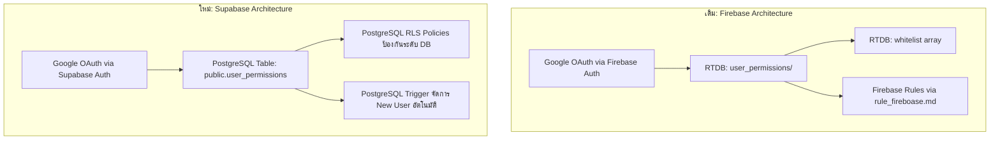

# แผนงานย้ายระบบ Authentication & Authorization จาก Firebase ไป Supabase

เอกสารนี้ระบุการวิเคราะห์และแผนการดำเนินงาน (Implementation Plan) ในการย้ายระบบเข้าสู่ระบบ (Login / Google OAuth), สิทธิ์ผู้ใช้งาน (Access Control / Whitelist), ช่วงทดลองใช้งาน (7-Day Free Trial), และโควต้าอัปโหลดรูปภาพ จาก **Firebase Authentication & Realtime Database** ไปยัง **Supabase (PostgreSQL + RLS + Supabase Auth)** ทั้งหมด

---

## 1. การเปรียบเทียบสถาปัตยกรรม (Firebase vs Supabase)



| คุณสมบัติ | ระบบเดิม (Firebase) | ระบบใหม่ (Supabase) |
| :--- | :--- | :--- |
| **Auth Provider** | Firebase Google Auth (`signInWithPopup`) | Supabase Google OAuth (`signInWithOAuth`) |
| **User Data Store** | Realtime Database (`user_permissions/<key>`) | PostgreSQL Table (`public.user_permissions`) |
| **Email Key Mapping** | ต้องแทนที่ `.` ด้วย `,` (`chomtan@gmail,com`) | รองรับ `email` แบบข้อความปกติ ไม่ต้องแปลง Key |
| **Security Rules** | `rule_fireboase.md` (JSON Rules) | PostgreSQL Row Level Security (RLS) + DB Triggers |
| **Data Types** | JSON Tree (Unstructured) | Relational SQL (Strict Types, Constraints, Default values) |
| **Client SDK** | `firebase/auth`, `firebase/database` | `@supabase/supabase-js` (มีในโปรเจกต์แล้ว) |

---

## 2. ฐานข้อมูลและสคริปต์ SQL สำหรับ Supabase (Database Design & Migration)

อ้างอิงจากฐานข้อมูล Supabase ปัจจุบันใน `now_db.md` (มี `leagues`, `teams`, `matches`) เราจะเพิ่มตาราง `user_permissions` พร้อม RLS Policies และย้ายข้อมูลจาก `authen-obs-scoreboard-default-rtdb-export (1).json`

### 2.1 โครงสร้างตาราง `user_permissions` (SQL Schema)

```sql
-- 1. สร้างตาราง user_permissions
CREATE TABLE IF NOT EXISTS public.user_permissions (
    id UUID PRIMARY KEY DEFAULT gen_random_uuid(),
    email TEXT UNIQUE NOT NULL,
    display_name TEXT DEFAULT '',
    photo_url TEXT DEFAULT '',
    status TEXT NOT NULL DEFAULT 'pending' CHECK (status IN ('allowed', 'denied', 'pending')),
    trial_started_at BIGINT, -- Timestamp ms สำหรับคำนวณ Trial 7 วัน
    last_login TIMESTAMPTZ DEFAULT now(),
    uploaded_image_count INT NOT NULL DEFAULT 0,
    created_at TIMESTAMPTZ DEFAULT now(),
    updated_at TIMESTAMPTZ DEFAULT now()
);

-- Index สำหรับค้นหา email อย่างรวดเร็ว
CREATE INDEX IF NOT EXISTS idx_user_permissions_email ON public.user_permissions (LOWER(email));
```

### 2.2 Row Level Security (RLS Policies) เทียบเท่า `rule_fireboase.md`

```sql
-- เปิดใช้งาน RLS
ALTER TABLE public.user_permissions ENABLE ROW LEVEL SECURITY;

-- 1. นโยบาย SELECT (อ่านข้อมูล)
-- Super Admin อ่านได้ทุกคน / ผู้ใช้ทั่วไปอ่านได้เฉพาะแถวของตนเอง
CREATE POLICY "Allow read user_permissions"
ON public.user_permissions
FOR SELECT
TO authenticated
USING (
    LOWER(auth.jwt() ->> 'email') = 'thanakrit_kas@hotmail.com'
    OR LOWER(email) = LOWER(auth.jwt() ->> 'email')
);

-- 2. นโยบาย INSERT (เพิ่มผู้ใช้ใหม่)
-- Super Admin เพิ่มได้ทุกคน / ผู้ใช้ใหม่เพิ่มตนเองได้ในสถานะ 'pending'
CREATE POLICY "Allow insert user_permissions"
ON public.user_permissions
FOR INSERT
TO authenticated
WITH CHECK (
    LOWER(auth.jwt() ->> 'email') = 'thanakrit_kas@hotmail.com'
    OR (
        LOWER(email) = LOWER(auth.jwt() ->> 'email')
        AND status = 'pending'
    )
);

-- 3. นโยบาย UPDATE (แก้ไขข้อมูล)
-- Super Admin แก้ได้ทุกฟิลด์
-- ผู้ใช้ทั่วไปแก้ได้เฉพาะชื่อ, รูป, last_login, uploaded_image_count ของตนเอง (ห้ามแก้ status และ trial_started_at)
CREATE POLICY "Allow update for super admin"
ON public.user_permissions
FOR UPDATE
TO authenticated
USING (LOWER(auth.jwt() ->> 'email') = 'thanakrit_kas@hotmail.com')
WITH CHECK (LOWER(auth.jwt() ->> 'email') = 'thanakrit_kas@hotmail.com');

CREATE POLICY "Allow update profile for self"
ON public.user_permissions
FOR UPDATE
TO authenticated
USING (LOWER(email) = LOWER(auth.jwt() ->> 'email'))
WITH CHECK (
    LOWER(email) = LOWER(auth.jwt() ->> 'email')
    -- ป้องกันการยกระดับสิทธิ์ตนเอง
    AND status = (SELECT p.status FROM public.user_permissions p WHERE p.id = user_permissions.id)
    AND (
        trial_started_at = (SELECT p.trial_started_at FROM public.user_permissions p WHERE p.id = user_permissions.id)
        OR (SELECT p.trial_started_at FROM public.user_permissions p WHERE p.id = user_permissions.id) IS NULL
    )
);
```

### 2.3 สคริปต์ย้ายข้อมูลประวัติเดิม (Data Migration from JSON)

ย้ายข้อมูล 5 รายการจาก `authen-obs-scoreboard-default-rtdb-export (1).json`:

```sql
INSERT INTO public.user_permissions (email, display_name, photo_url, status, trial_started_at, last_login, uploaded_image_count)
VALUES
    (
        'thanakrit_kas@hotmail.com',
        'VAR Live Stream',
        'https://lh3.googleusercontent.com/a/ACg8ocJ6A9FbmjMneHdSagjbchd-AdzoUU7ATrhgtRtI-R84-Hs-1FYD=s96-c',
        'allowed',
        NULL,
        '2026-09-02T05:26:06.843Z'::timestamptz,
        3
    ),
    (
        'chomtanphetchaburi@gmail.com',
        'ธนกฤต กาสี',
        'https://lh3.googleusercontent.com/a/ACg8ocIzjej8w_XVicioZUNJuLts6n3ydXirwh8jV90virrLgTnOIuRN=s96-c',
        'allowed',
        1787562815672,
        '2026-09-02T05:29:39.360Z'::timestamptz,
        0
    ),
    (
        'kasthanakrit4@gmail.com',
        'Thanakrit kas',
        'https://lh3.googleusercontent.com/a/ACg8ocLmomFvaGmuLxwX9VDxKfyCPH2MSzso0SxHelHls-KFL5y6Ow=s96-c',
        'allowed',
        1787472458109,
        '2026-09-02T05:20:31.384Z'::timestamptz,
        0
    ),
    (
        'jeab.chomtan@gmail.com',
        'ชาญณรงค์ ลิ้มวารีรัตน์',
        'https://lh3.googleusercontent.com/a/ACg8ocJaE1mma7h-kM8KLxs50Xusmiv9nohhg_OGER-IzVvlcUJeSA=s96-c',
        'pending',
        1788183565902,
        '2026-09-02T05:29:40.157Z'::timestamptz,
        0
    ),
    (
        'nutshasucho@gmail.com',
        'Sucho Nutsha',
        'https://lh3.googleusercontent.com/a/ACg8ocJXrur8rq6FttyUlyMSpt8zI1V8BTqP57xExzezkwuROMtsAA=s96-c',
        'pending',
        1788326783279,
        '2026-09-02T05:26:23.815Z'::timestamptz,
        0
    )
ON CONFLICT (email) DO UPDATE SET
    display_name = EXCLUDED.display_name,
    photo_url = EXCLUDED.photo_url,
    status = EXCLUDED.status,
    trial_started_at = COALESCE(user_permissions.trial_started_at, EXCLUDED.trial_started_at),
    last_login = EXCLUDED.last_login,
    uploaded_image_count = EXCLUDED.uploaded_image_count;
```

---

## 3. รายการไฟล์ที่จะเปลี่ยนแปลงใน React (Proposed Frontend Changes)

### 3.1 สร้าง Service ใหม่ `src/services/supabaseAuthService.ts` [NEW]
สร้าง Service จัดการ Auth + Permissions บน Supabase แทนที่ `firebaseAuth.ts`:
- `loginWithGoogle()`: เรียก `supabase.auth.signInWithOAuth({ provider: 'google', ... })`
- `logoutUser()`: เรียก `supabase.auth.signOut()`
- `getAuthUser()`: ดึง User ปัจจุบันจาก `supabase.auth.getUser()`
- `onAuthStateChange()`: Subscribe สถานะ Login จาก Supabase
- `recordUserLoginAttempt()`: Upsert ข้อมูลโปรไฟล์และ timestamp ลงตาราง `user_permissions`
- `verifyUserWhitelist()`: ตรวจสอบสิทธิ์ (Super Admin -> DB status -> Trial evaluation -> Fallback)
- `fetchAllUserPermissions()`: ดึงข้อมูลผู้ใช้ทั้งหมดสำหรับหน้า Admin
- `setUserAccessStatus()`: อัปเดตสถานะ Allow / Deny / Pending

### 3.2 ปรับปรุง `src/components/AuthGuard.tsx` [MODIFY]
- เปลี่ยนจากการเชื่อมต่อ Firebase Auth ไปใช้ `supabaseAuthService`
- จัดการ Flow การ Callback หลังจาก Google OAuth Redirect บน Supabase อย่างราบรื่น
- รักษา Logic ตรวจสอบ Trial 7 วัน และ Real-time Expiry Timer

### 3.3 ปรับปรุง `src/components/AdminWhitelist.tsx` [MODIFY]
- เปลี่ยนการดึงและบันทึกสิทธิ์ผู้ใช้จาก Firebase Realtime DB ไปยัง Supabase `user_permissions`
- แก้ไขคำแนะนำในหน้าจอให้สอดคล้องกับ Supabase SQL / Dashboard

### 3.4 ปรับปรุง `src/hooks/useImageUploadQuota.ts` [MODIFY]
- ดึงและนับ `uploaded_image_count` ผ่าน Supabase `user_permissions` แทน Firebase RTDB

### 3.5 ปรับปรุง `src/config/supabaseClient.ts` [MODIFY]
- เพิ่ม Type `UserAccessRecord` และ Export Helper functions

---

## 4. แผนการตรวจสอบและทดสอบ (Verification Plan)

### 4.1 Automated & Build Tests
- รัน `npm run build` ตรวจสอบ TypeScript Type Checking
- รัน `npm test` เพื่อให้แน่ใจว่าไม่มี Regression ในระบบเดิม

### 4.2 Manual Verification Steps
1. **Google Login Flow**: กดปุ่ม Sign in with Google ผ่าน Supabase OAuth และ Redirect กลับมาที่แอปสำเร็จ
2. **Super Admin Access**: เข้าใช้งานด้วย `thanakrit_kas@hotmail.com` ได้สิทธิ์ `super-admin` และเข้าหน้า `/admin/whitelist` ได้
3. **Whitelist & Trial Test**:
   - ผู้ใช้ `chomtanphetchaburi@gmail.com` และ `kasthanakrit4@gmail.com` ได้สถานะ `whitelist`
   - ผู้ใช้ `jeab.chomtan@gmail.com` และ `nutshasucho@gmail.com` ได้สถานะ `trial` พร้อมแสดงจำนวนวันคงเหลือ
   - ผู้ใช้ใหม่ที่ยังไม่เคยมีในระบบ ล็อกอินแล้วเข้าสู่สถานะ `trial` 7 วัน
4. **Admin Management**: Super Admin สามารถกด Allow / Deny / ตั้งเป็น Pending บนตาราง Supabase ได้ทันที
5. **Quota Check**: การอัปโหลดรูปภาพบันทึกยอดนับลงฟิลด์ `uploaded_image_count` บน Supabase ถูกต้อง
